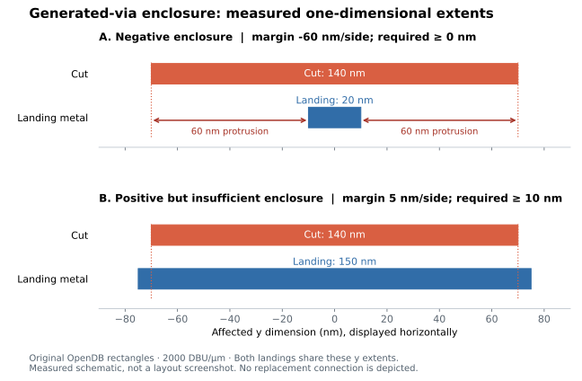

# OpenROAD: catching malformed generated vias

**Mahmoud Sub Laban · C++ / physical design / regression testing**

[Issue #11538](https://github.com/The-OpenROAD-Project/OpenROAD/issues/11538)
· [PR #11539](https://github.com/The-OpenROAD-Project/OpenROAD/pull/11539)
· [Submitted patch](https://github.com/The-OpenROAD-Project/OpenROAD/pull/11539/files)

**Status, September 27, 2026:** submitted and open, pending upstream review.
DCO passes; upstream build/lint workflows await maintainer approval. Local
verification is separate from upstream CI and acceptance.

## What failed?

During my master's research, a power-grid investigation exposed malformed
generated-via geometry. A public synthetic reproduction accepted a **140 nm
cut with a 20 nm landing** in one direction: **60 nm protruded on each side**.
A second reproduction had 5 nm enclosure where its synthetic rule required
10 nm. Native supply-connectivity checks passed in both cases; connectivity
alone did not establish legal geometry.



*Measured schematic, not a layout screenshot: only the affected y dimension
is shown, horizontally. Both landing layers share these y extents. The plot
uses [OpenDB rectangle measurements](measured-enclosures.csv); it does not
depict a replacement connection.*

## Why did it fail?

The final generated-via check requested applicable enclosure rules but omitted
the VIARULE default when no cut-layer override existed. An empty rule list then
passed validation. Integer halving and manufacturing-grid snapping could also
round a small negative margin to an apparently legal zero.

## What changed?

I submitted a focused correction in `src/pdn/src/via.cpp`: use the default
independently for each landing **only when no applicable overriding rule exists**,
and preserve negative margins with floor division and signed grid snapping.
Existing override selection and legal landing-extension attempts remain.
This follows the default/override distinction in the
[LEF/DEF reference, Via Rule Generate](https://coriolis.lip6.fr/doc/lefdef/lefdefref/LEFSyntax.html).

## How was it tested?

The new Tcl regressions inspect actual OpenDB cut and landing rectangles,
independently of PDN's fit predicate. Both defect assertions fail on the original
complete executable and pass with the correction. The valid control's DEF and
geometry tables are byte-identical. The existing stacked-via override test
passes unchanged.

The final local PDN suite passes **207/207 tests**, including three new tests.
This was a fresh execution using previously built, verified binaries whose
production-source equivalence was checked after formatting; no fresh Bazel
build is claimed. Eleven expected-output pairs were reviewed for physical
consequences, individually documented in the PR. C++, Tcl and Bazel formatting
checks pass locally.

### Reproduce

Build two complete OpenROAD executables with matching dependencies using the
[upstream build instructions](https://github.com/The-OpenROAD-Project/OpenROAD/blob/80c6be93c28244f9f72840852a667daef764a4ff/docs/user/Build.md):

| Version | Source commit |
| --- | --- |
| Original | `80c6be93c28244f9f72840852a667daef764a4ff` |
| Corrected | `6b3d456caab98deb34a1511327299d42fbcf9065` |

Then use Bash, curl and those executables:

```bash
git clone https://github.com/MahmoudNedalSubLaban/MahmoudNedalSubLaban.git
cd MahmoudNedalSubLaban/case-studies/openroad-pdn
export OPENROAD_BEFORE=/absolute/path/to/original/openroad
export OPENROAD_AFTER=/absolute/path/to/corrected/openroad
bash reproduce.sh
```

The script fetches only pinned public test files, reuses OpenROAD's existing
regression assertions and writes to a fresh temporary directory. Existing
library notices are retained. Expected exits for edge/positive/valid are
`1/1/0` before and `0/0/0` after; invalid generated-instance counts are `1/1/0`
before and `0/0/0` after. Native VDD/VSS checks pass in these small cases.
Inspect `via_geometry.tsv` for rectangle bounds and margins. No private netlist,
checkpoint, restricted input package or prebuilt database is required.

The [upstream regression README](https://github.com/MahmoudNedalSubLaban/OpenROAD/blob/6b3d456caab98deb34a1511327299d42fbcf9065/src/pdn/test/generated_via_enclosure/README.md)
also contains direct commands and interpretation. To regenerate this figure:
`python -m pip install matplotlib==3.10.7` and `python draw_geometry.py`.

## What remains unresolved?

Rejecting an illegal via does **not** guarantee a replacement connection. One
already-disconnected existing test network reports more disconnected shapes
after rejection. DFT68's separate `PDN-0179` construction failure is unresolved.
No full-chip PPA improvement, universal PDN repair, process DRC or electrical
sign-off is claimed. Upstream CI approval and maintainer review remain pending;
the live PR is the source of truth for acceptance.
